# Smart Transit WebGIS

基于 Cesium、Vue 3、Spring Boot 与 PostGIS 构建的三维智慧公交 WebGIS。项目以深圳市福田区为展示区域，将公交线路、站点、实时车辆、到站预测、运营异常、周边 POI 与历史轨迹统一组织在一个地图工作台中。

系统当前可同时模拟 **304 条线路、912 辆公交车**。前端根据观察距离在三维模型、点图元和地理网格之间自动切换，并通过视野裁剪与平滑插值兼顾区域总览性能和近景业务表现。

<p align="center">
  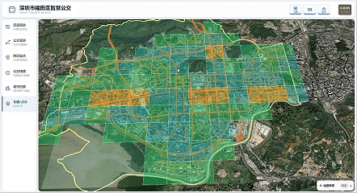
</p>

<p align="center">
  
  
  
  
  
</p>

**快速导航**：[项目亮点](#项目亮点) · [功能展示](#功能展示) · [系统架构](#系统架构) · [实时车辆渲染策略](#实时车辆渲染策略) · [技术栈](#技术栈) · [数据规模](#数据规模) · [目录结构](#目录结构) · [快速开始](#快速开始) · [使用方式](#使用方式) · [常见问题](#常见问题) · [API 概览](#api-概览) · [核心配置](#核心配置) · [构建与测试](#构建与测试)

## 项目亮点

- **一体化地图工作台**：使用顶部视图控制、左侧功能导航、右侧上下文工作台和底部线路站序组织复杂公交业务，面板只在需要时占用地图空间。
- **区域级车辆仿真**：后端按线路里程推进车辆，包含行驶、进站减速和停靠状态，默认以 1 秒为目标周期更新并通过 WebSocket/STOMP 广播车辆快照。
- **分级车辆渲染**：近景使用三维公交模型，中景使用 `PointPrimitiveCollection`，远景按 Web Mercator 投影下边长 1000 米的网格聚合车辆数量。
- **实时渲染优化**：自动 LOD 使用进入/退出阈值减少频繁切换，点和模型渲染结合带缓冲区的视野裁剪，并保留选中车辆。
- **平滑实时动画**：前端对车辆位置和详情面板中的业务指标进行插值，降低周期性跳动；车辆循环回到线路起点时直接更新位置，避免跨线插值。
- **公交轨迹漫游**：支持从地图或车辆详情进入实时跟车视角，高亮车辆所属线路，并在底部展示已通过、上一站、下一站和后续站点。
- **三维公交设施**：近景显示带朝向的公交车模型、线路/车辆标签以及三维公交站牌，选中的站牌会获得轮廓高亮。
- **公交业务联动**：线路、车辆、站点、到站预测与运营异常相互联动，可从面板直接定位地图对象。
- **运营状态分析**：根据同线路车辆的沿线距离间隔识别串车和大间隔，当前页面保留最近 50 条异常发现与恢复事件。
- **站点服务分析**：以地图点击位置为中心查询附近公交站和 POI，支持 300、500、800 米常用半径及六类 POI 统计。
- **时空轨迹回放**：支持单车、线路多车和全网三种历史回放模式，可调节倍速并跟随指定车辆。
- **多种地图视图**：支持卫星影像与 OSM 道路图切换、二维/三维场景切换以及地形开关。
- **首屏加载面板**：地图初始化按阶段提示进度，资源失败或超时时列出未完成项，可在“重新加载”和“降级进入”之间选择。
- **空间数据库支撑**：使用 PostGIS 保存线路、站点、道路、POI 与车辆历史位置，并建立 GiST 空间索引。

## 功能展示

### 首屏加载与降级进入

地图加载面板按初始化流程展示当前进度，依次经历初始化三维场景、定位福田区、加载地图影像与地形、加载城市建筑与公交数据、完成首屏地图渲染五个阶段。加载期间面板显示阶段名称和状态提示，全部资源就绪后自动关闭；部分资源加载失败或等待超时时，面板停留在“部分资源加载较慢”并列出未完成的资源，可选择重新加载或降级进入已经就绪的核心地图。


### 三维公交总览与自动 LOD

福田区行政边界、道路网络、公交线路和实时车辆在同一场景中联动展示。远距离观察时，车辆会自动聚合为带数量和颜色分级的地理网格；降低相机高度退出聚合后，再按相机到每辆车的距离显示点图元（`PointPrimitive`）或三维 GLB 模型。

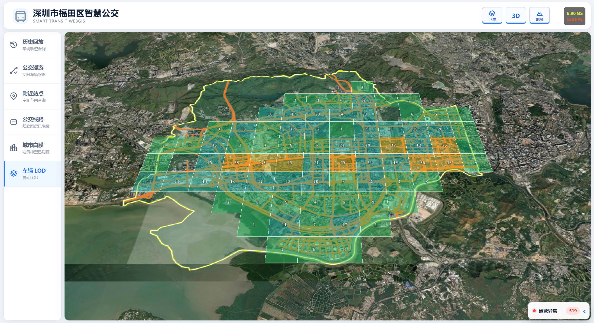

### 线路查询与站点高亮

点击地图中的公交线路即可高亮完整线路，并在右侧工作台查看线路编号、起终点、城市和省份等属性。线路站点使用带名称标签的三维站牌表示。

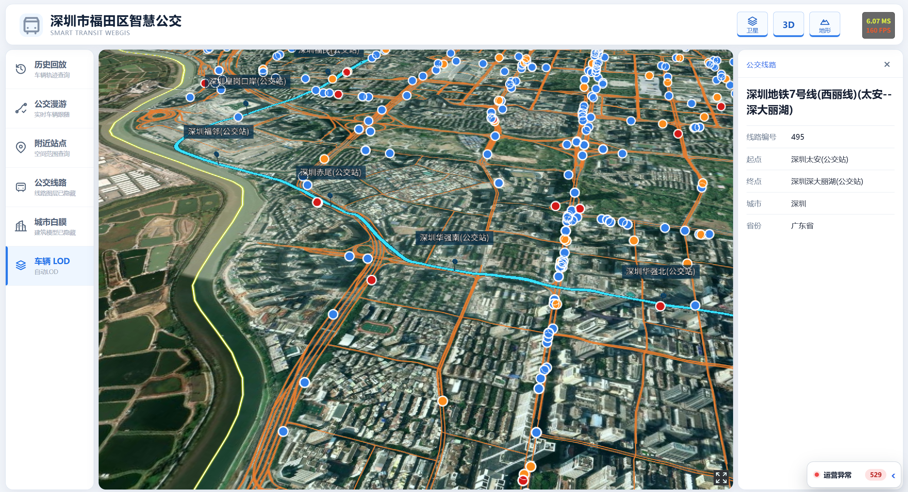

### 实时车辆监控

进入近景后，车辆由点图元自动切换为带朝向的三维公交模型。选择车辆可查看所属线路、行驶与运营状态、上下站点、当前速度和前车间隔，并可直接开始实时追踪。

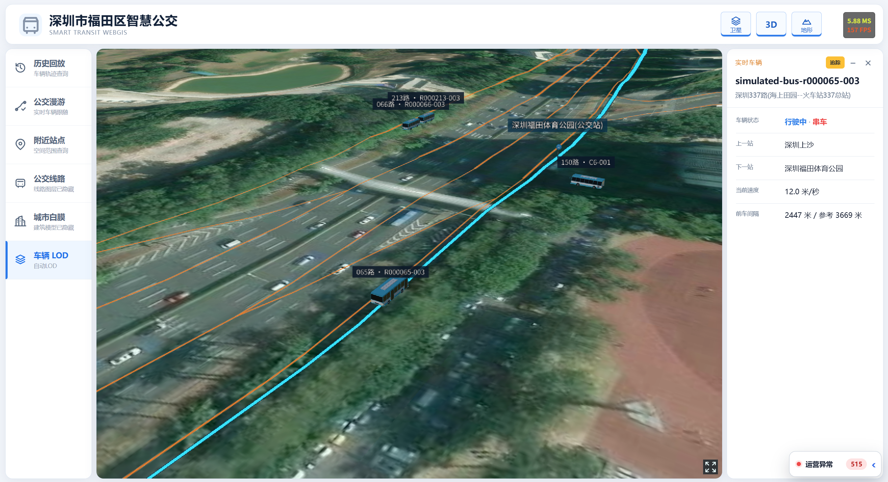

### 实时公交轨迹漫游

公交漫游模式会持续跟随选中的实时车辆，高亮其运行线路，并在地图底部展示完整站序。站序面板实时标记已通过站点、上一站、下一站、车辆在线路中的位置及距下一站距离。

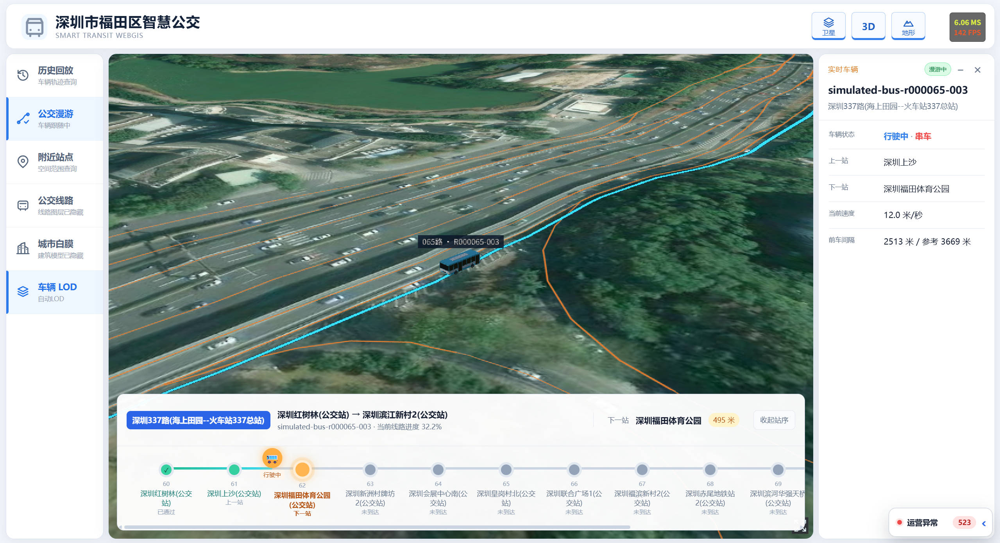

### 站点到站预测

选择有运行中仿真车辆的线路站牌后，可查看当前站序、最近车辆与后续车辆的预计到站时间、剩余站数和距离。到站请求完成后默认间隔 2 秒再次刷新，并可从候车列表直接定位车辆。当前 ETA 按剩余沿线距离除以配置的巡航速度估算，尚未计入途中减速、停靠和额外延误时间。

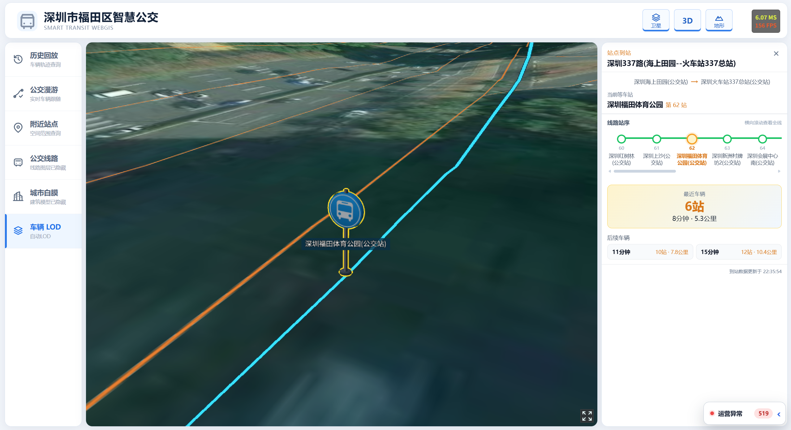

### 附近站点与 POI 服务分析

开启“附近站点”后点击地图，即可在指定半径内检索公交站，并统计医疗保健、科教文化、购物消费、餐饮美食、休闲娱乐和交通设施六类 POI。点击图表分类可筛选地图上的 POI 点位，站点列表按距离排序；两类查询共用半径，可通过 0～1000 米滑动条或 300、500、800 米快捷值调整，设为 0 时清空结果。

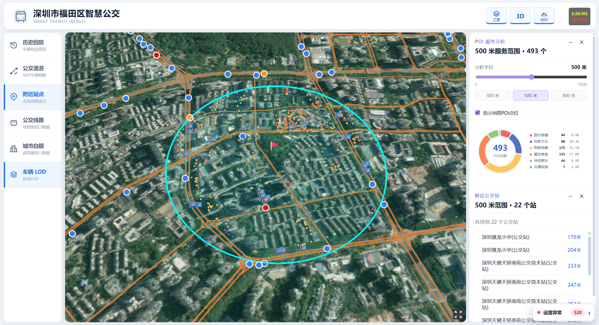

### 运营异常播报

系统以“有效仿真线路长度 ÷ 配置车辆数”为参考间隔，当前车距低于参考值的 70% 时判定为串车，高于 130% 时判定为大间隔。异常播报面板支持折叠，也可通过“查看”快速定位对应车辆和线路。事件列表保存在当前页面内存中，最多 50 条，刷新页面后重新记录；角标显示的是当前异常车辆数。

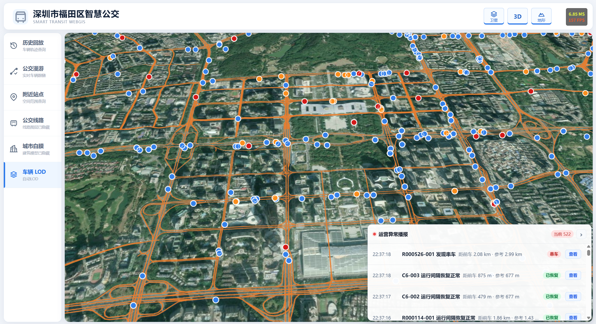

### 历史轨迹回放

车辆位置默认每 5 秒采样，按 1 天保留期每小时清理过期数据。回放支持单车、线路多车和全网模式，可选择时间范围、切换 1×/2×/5×/10× 倍速、拖动 Cesium 时间轴，并选择车辆进行镜头跟随。历史车辆使用点标记显示，实时车辆 LOD 切换在回放模式下禁用。

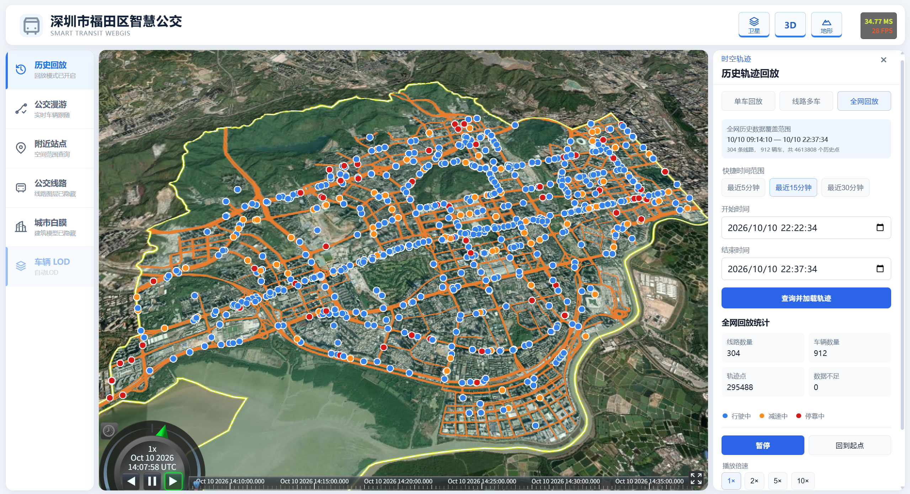

下面的动图展示了全网历史回放，以及从跟随车辆列表中选择一辆车后进入镜头跟随的过程。

<p align="center">
  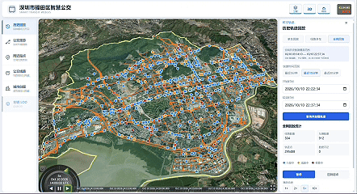
</p>

## 系统架构

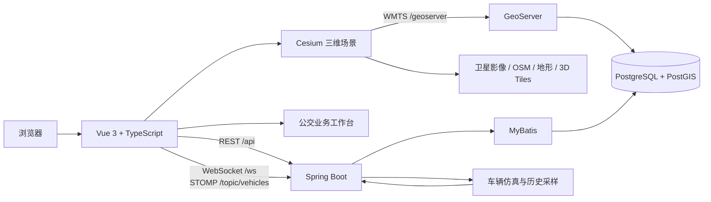

实时车辆链路：

```text
车辆仿真任务
    → 车辆运行时状态
    → STOMP 默认每秒广播
    → 自动模式下按视野筛选点 / 模型车辆
    → 自动 LOD：三维模型 / 点图元 / 地理网格
    → 点 / 模型位置插值
    → Cesium 实时渲染

车辆运行时状态
    → 每 5 秒批量采样
    → PostGIS 历史位置表
    → 单车 / 线路 / 全网轨迹查询与回放
```

## 实时车辆渲染策略

前端提供“自动 LOD”和“全部点”两种显示模式，便于在正常使用和渲染调试之间切换。自动模式按照相机状态选择合适的表现层：

| 场景 | 表现方式 | 当前阈值 |
|---|---|---|
| 近距离观察 | 三维公交模型与车辆标签 | 相机到单辆车距离 ≤800 米进入，≥1000 米退出 |
| 中距离观察 | Cesium 点图元 | 模型范围之外、网格聚合范围之内 |
| 区域级总览 | Web Mercator 投影下 1000 米网格聚合 | 相机高度达到 3500 米进入，降至 2500 米退出 |

进入和退出阈值不相同，用于避免相机处于临界位置时车辆表现反复切换。自动模式下，点和模型车辆按相机可见的经纬度矩形筛选，四周各扩展 15% 缓冲范围，并始终保留选中车辆。远景网格按全部快照聚合，颜色按照车辆数量固定分级；“全部点”模式不做视野裁剪。

## 技术栈

| 层级 | 技术 |
|---|---|
| 前端框架 | Vue 3、TypeScript、Vite |
| 三维 GIS | CesiumJS、GeoJSON、3D Tiles、WMTS |
| 数据可视化 | Apache ECharts |
| 实时通信 | WebSocket、STOMP |
| 后端 | Java 17、Spring Boot、Spring Web MVC |
| 数据访问 | MyBatis |
| 数据库 | PostgreSQL 14、PostGIS 3.5 |
| 地图服务 | GeoServer 2.28、GeoWebCache |
| 本地基础设施 | Docker Compose |

## 数据规模

仓库数据文件及当前仿真配置的规模如下：

| 数据 | 数量 | 说明 |
|---|---:|---|
| 线路记录 | 616 | `MultiLineString`，EPSG:4326；原始数据包含公交及地铁线路 |
| 站点记录 | 4,934 | `Point`，EPSG:4326；按原始站点记录计数，非去重后的物理站点数 |
| 线路—站点关系 | 4,934 | 带线路内站序 |
| 城市道路 | 2,941 | 仓库 GeoJSON 中的记录数；需另行导入道路表 |
| POI | 依导入数据而定 | `Point`，六类服务设施；完整原始数据未随仓库提供 |
| 仿真线路 | 304 | 每条线路默认生成 3 辆车 |
| 仿真车辆 | 912 | 配置数量，实际运行数量取决于线路数据校验结果 |

线路高亮和站序使用数据库中已有的几何与站点记录；部分线路仅保留福田区域内的站点，站序可能不从 1 开始。仿真使用通过首末站投影及站序校验的有效线路区间，到达末端后循环回到起点。

## 目录结构

```text
smart-transit-webgis/
├── backend/                  # Spring Boot 后端
│   └── src/main/
│       ├── java/             # Controller、Service、仿真与 WebSocket
│       └── resources/        # application.yml 与 MyBatis XML
├── database/                 # 建表、数据导入、空间索引与验证脚本
├── deploy/                   # 生产 Dockerfile、Nginx 与 Compose 模板
├── docs/
│   ├── images/               # README 截图与 GIF
│   └── performance/          # 车辆仿真与城市白膜性能记录
├── frontend/                 # Vue 3 + Cesium 前端
│   ├── public/
│   │   ├── data/             # 公交站点与线路关系数据
│   │   ├── models/           # 公交车与公交站牌 GLB 模型
│   │   └── test-data/        # 边界、线路、道路与站点数据
│   └── src/
│       ├── components/       # 业务工作台和信息面板
│       ├── composables/      # 地图图层、实时车辆与业务逻辑
│       ├── config/           # Cesium 与公交业务配置
│       ├── types/            # TypeScript 类型
│       └── views/            # 三维公交地图页面
├── scripts/                  # 静态道路瓦片生成脚本
├── .env.example              # Docker 环境变量模板
└── docker-compose.yml        # PostGIS 与 GeoServer
```

## 快速开始

### 1. 环境要求

- Node.js 20.19+ 或 22.12+
- npm（使用仓库的 `package-lock.json` 安装依赖）
- Java 17+
- Docker Desktop / Docker Compose
- 可选：QGIS，用于导入道路和完整 POI 数据
- 可访问外部地形、影像、OSM 与 3D Tiles 服务的网络环境

### 2. 配置本地密码

在项目根目录复制环境变量模板：

```powershell
Copy-Item .env.example .env
```

编辑 `.env`，将示例值替换为本机密码：

```dotenv
SMART_TRANSIT_DB_PASSWORD=your-local-database-password
GEOSERVER_ADMIN_PASSWORD=your-local-geoserver-password
```

`.env` 已被 Git 忽略，请勿提交真实密码。

### 3. 启动 PostGIS 与 GeoServer

```powershell
docker compose up -d
docker compose ps
```

| 服务 | 地址 |
|---|---|
| PostgreSQL/PostGIS | `127.0.0.1:15433` |
| GeoServer | `http://localhost:8081/geoserver` |

### 4. 初始化数据库

以下 PowerShell 命令用于首次初始化空数据库，会导入仓库内可直接复现的线路和站点数据，并创建道路、POI 与历史轨迹表。已有数据库应按需执行缺少的脚本，建表脚本并非全部支持重复执行。

```powershell
$OutputEncoding = [System.Text.UTF8Encoding]::new($false)

$scripts = @(
  'create_schema.sql',
  'create_indexes.sql',
  'import_routes_raw.sql',
  'load_routes.sql',
  'load_stops_and_route_stops.sql',
  'add_vehicle_position_history.sql',
  'create_city_roads.sql',
  'create_pois.sql',
  'verify_database.sql'
)

foreach ($script in $scripts) {
  Get-Content -Raw -Encoding UTF8 ".\database\$script" |
    docker compose exec -T postgis psql `
      -v ON_ERROR_STOP=1 `
      -U smart_transit `
      -d smart_transit
  if ($LASTEXITCODE -ne 0) { throw "数据库脚本执行失败：$script" }
}
```

基础线路、站点和车辆仿真可以直接使用仓库数据。城市道路原始 GeoJSON 位于 `frontend/public/test-data/futian-bus-roads.geojson`，完整 POI 原始数据未提交到仓库；二者的 QGIS 导入步骤请参阅 [`database/README.md`](database/README.md)。

上述命令不会填充道路和 POI 表。复现截图中的道路与 POI 点位，还需分别准备 `city_roads_import_raw` 和 `futian_poi_final` 原始表，再执行 `load_city_roads.sql`、`load_pois.sql`；未导入 POI 时，附近公交站仍可查询，POI 统计为 0。

### 5. 配置 GeoServer 道路图层（可选）

如需显示城市道路 WMTS，请在 GeoServer 中完成以下配置：

1. 创建工作区 `smart_transit`。
2. 创建 PostGIS 数据存储，容器内数据库地址为 `postgis:5432`，数据库和用户名均为 `smart_transit`。
3. 发布 `public.city_roads`，图层名保持为 `smart_transit:city_roads`。
4. 创建并指定样式 `smart_transit:city_roads_style`。
5. 在 Tile Caching 中启用 `EPSG:900913` 和 PNG 输出。

当前仓库未包含 GeoServer 数据目录及道路 SLD，因此这部分需要在本机配置。未配置时核心公交功能仍可运行，但道路 WMTS 不会显示。

### 6. 启动后端

打开新的 PowerShell 窗口：

```powershell
cd backend
$env:SMART_TRANSIT_DB_PASSWORD = 'your-local-database-password'
.\mvnw.cmd spring-boot:run
```

后端默认运行在 `http://localhost:8080`，按配置加载仿真线路并生成车辆；可通过 `/api/vehicles/current` 核对实际运行数量。根目录 `.env` 供 Docker Compose 使用，单独启动后端仍需设置上述环境变量。首次启动后需要积累历史采样，每辆车在查询时间范围内至少有 2 个点才可回放。

### 7. 启动前端

再打开一个 PowerShell 窗口：

```powershell
cd frontend
npm ci
npm run dev
```

浏览器访问 `http://localhost:5173`。Vite 开发服务器会将 `/api` 和 `/ws` 代理到后端，将 `/geoserver` 代理到 GeoServer。

## 使用方式

1. 使用顶部按钮切换卫星/OSM 底图、二维/三维场景以及地形/平面模式。
2. 使用左侧“公交线路”“城市白膜”和“车辆 LOD”控制地图图层与车辆表现。
3. 点击地图线路，在右侧查看线路详情和完整线路高亮。
4. 降低相机高度后点击三维公交车，在右侧查看实时运行状态。
5. 点击车辆面板中的“追踪”，或先进入“公交漫游”再选择车辆，开启实时跟车和底部站序进度。
6. 在线路高亮后点击三维站牌，查看站序以及最近和后续车辆的到站预测。
7. 点击“附近站点”后在地图选点，查看公交站和 POI 服务范围，可调整查询半径并筛选 POI 分类。
8. 展开“运营异常播报”，点击事件后的“查看”定位发生串车或大间隔的车辆。
9. 点击“历史回放”，选择单车、线路多车或全网模式，设置时间范围后加载轨迹并控制播放。

> 历史轨迹默认每 5 秒采样一次，保留期为 1 天，过期数据每小时清理；单次查询时间范围最长为 120 分钟。刚完成首次启动时，历史数据列表可能为空。

## 常见问题

- **打开后长时间停留在加载面板**：外部影像、地形或城市白模较慢时，面板会列出未完成的资源，可点“降级进入”先使用核心地图，或点“重新加载”重试。
- **历史回放列表为空**：后端需要先积累采样，单辆车在查询时间范围内至少有 2 个点才可回放。
- **地图上看不到城市道路**：GeoServer 道路图层尚未按第 5 步配置，核心公交功能不受影响。
- **POI 统计为 0**：原始 POI 数据未导入，附近公交站查询仍然可用。

## API 概览

| 方法 | 路径 | 说明 |
|---|---|---|
| GET | `/api/routes` | 查询全部线路属性 |
| GET | `/api/routes/geojson` | 获取线路 GeoJSON |
| GET | `/api/routes/{routeId}/stops` | 查询指定线路的有序站点 |
| GET | `/api/route-stops` | 查询线路—站点关系 |
| GET | `/api/stops` | 查询全部站点 |
| GET | `/api/stops/nearby` | 查询指定坐标附近的公交站 |
| GET | `/api/stops/{stopId}/arrivals` | 查询指定线路的站点到站预测 |
| GET | `/api/pois/nearby` | 查询指定范围内的 POI 明细 |
| GET | `/api/pois/summary` | 统计指定范围内的 POI 分类 |
| GET | `/api/vehicles/current` | 查询当前车辆快照 |
| GET | `/api/vehicles/history/availability` | 查询历史数据可用范围 |
| GET | `/api/vehicles/history/{vehicleId}/trajectory` | 查询单车历史轨迹 |
| GET | `/api/vehicles/history/routes/{routeId}/trajectories` | 查询线路多车轨迹 |
| GET | `/api/vehicles/history/network/trajectories` | 查询全网同步轨迹 |
| WS/STOMP | `/ws` → `/topic/vehicles` | 订阅实时车辆快照 |

历史轨迹查询需传入 `startTime`、`endTime`，使用 ISO-8601 UTC 格式，例如 `2026-10-10T14:00:00Z`。附近站点和 POI 查询需传入 `longitude`、`latitude`，`radiusMeters` 默认 500，接口上限分别为 5000 和 1000 米；到站查询需传入 `routeId`，`limit` 默认 3、最大 10。

除线路 GeoJSON 接口直接返回 `FeatureCollection` 外，REST 接口使用 `{ code, msg, data }`，`code=1` 表示成功、`code=0` 表示业务失败；STOMP 消息直接返回车辆快照数组。

## 核心配置

- 后端数据库、304 条仿真线路、车辆速度、运营异常阈值和历史采样：`backend/src/main/resources/application.yml`
- 前端接口、POI 半径、回放倍速、车辆模型与 LOD 阈值：`frontend/src/config/transit.config.ts`
- 底图、地形、白膜、行政边界与 FPS 调试开关：`frontend/src/config/cesium.config.ts`
- 本地代理与 Cesium 静态资源：`frontend/vite.config.ts`
- GeoServer WMTS 图层参数：`frontend/src/composables/useCityRoadWmtsLayer.ts`

## 构建与测试

前端生产构建：

```powershell
cd frontend
npm run build
```

后端测试：

```powershell
cd backend
.\mvnw.cmd test
```

数据库验证：

```powershell
Get-Content -Raw .\database\verify_database.sql |
  docker compose exec -T postgis psql -U smart_transit -d smart_transit
```
